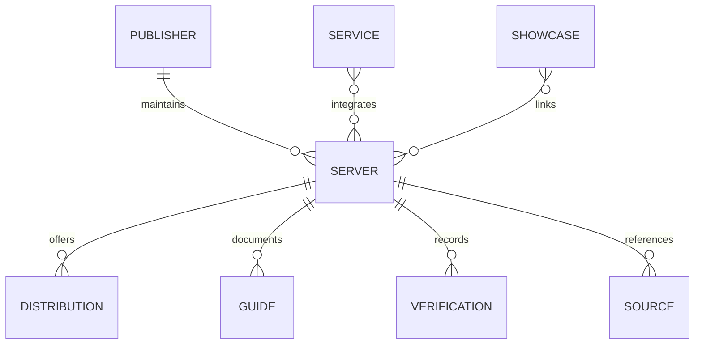
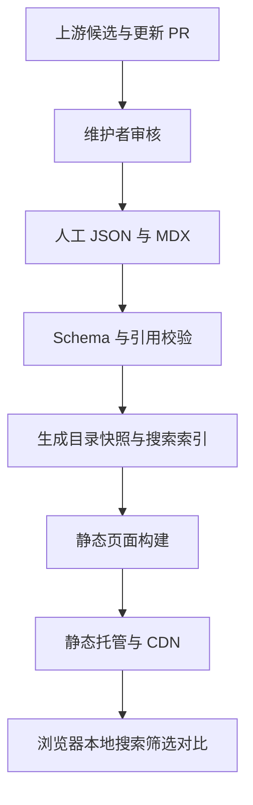

# 跨平台 MCP 聚合导航站：开发需求与设计文档

版本：v1.0 · 日期：2026-10-22 · 状态：可用于首版开发拆解

项目代号：MCP Atlas（暂定，未进行名称及域名可用性检查）。

本文是需求与方案设计，不代表网站已经开发、上线或完成实测。文中数量、排期和指标均为计划目标；竞品事实与产品建议分别标注。

## 1. 产品决策摘要

做一个开源、跨公司、跨开发者的 MCP 导航网站。用户按任务或所用服务找到 MCP，对比不同实现，查看有来源的中文说明，再前往项目官网或按指南配置。

同时设置“作者作品”专区，展示站点作者开发的 MCP、实际案例与源码。作者项目进入公共目录时遵守相同收录和排序规则，并标注利益关系。

首版采用“精选目录 + GitHub 协作 + 静态数据发布”，先完成发现、判断、配置、纠错的闭环。自动发现产生候选数据，审核后发布。暂不承担 MCP 托管、代理连接或用户密钥管理。

关键决策：

| 问题 | 首版决定 | 原因 |
|---|---|---|
| 是否收录所有 MCP | 定位为跨生态收录，不承诺全量覆盖 | 没有能证明全网完整覆盖的数据源 |
| 是否只收录开源 MCP | 同时允许开源和闭源远程服务，明确区分 | “网站开源”和“被收录服务开源”是不同属性 |
| 最大特色 | 同服务多实现对比、中文上手、证据与日期 | 搜索、分类、收录数量已有成熟竞争者 |
| 首批规模 | 30～50 个审核项目、至少 8 类场景 | 先验证内容维护成本和用户价值 |
| 用户登录 | 首版不做站内账号 | 搜索和复制配置无需登录；贡献走 GitHub |
| 数据存储 | Git 中的结构化 JSON + MDX 指南 | 版本可审计，社区容易贡献，减少运维 |
| 数据更新 | 定时生成更新 PR，人工审阅发布 | 避免上游错误或恶意变更直接进入网站 |
| 网站语言 | 中文优先，保留英文名称和别名 | 降低首版翻译维护量，保留扩展能力 |

## 2. 现状核实与机会判断

### 2.1 已核实的现有产品

截至上述日期，下列平台均已有跨项目发现能力。这里只记录公开页面可观察能力，不推断其后台质量、商业表现或完整覆盖率。

| 产品 | 可观察能力 | 对本项目的启示 |
|---|---|---|
| Official MCP Registry | 公共 MCP 服务注册与元数据接口 | 作为候选来源与身份线索，避免重复建设注册基础设施 |
| Glama | MCP 目录、属性筛选、排序、质量与维护相关信息 | “有分类”“有评分”本身不足以形成竞争优势 |
| PulseMCP | 服务目录、提供者分类、搜索与排序 | 官方/社区区分和按服务查找已有先例 |
| MCP.so | 项目发现、分类、服务端与客户端入口 | 通用导航存在竞争，需要明确内容特色 |
| Smithery | 跨服务发现与连接相关入口 | 连接托管的运营复杂度较高，首版聚焦导航 |

来源见第 21 节。竞品功能持续变化，不把当前项目数量或排名作为长期产品依据。

### 2.2 值得验证的用户痛点

以下是产品假设，需要通过用户任务测试验证：

1. 搜到多个同名 MCP，却无法判断哪一个由服务商维护。
2. 不理解免费代码与付费底层 API 的区别，接入后才发现成本。
3. 英文 README 或通用配置无法直接指导当前客户端。
4. 有收录但缺少来源日期、版本与测试范围，无法判断信息是否仍适用。
5. 只知道“整理飞书资料”等任务，不知道该搜索哪个项目名称。

网站的核心回答应是：“哪个实现适合我，为什么，以及我下一步怎么用。”

### 2.3 可行性与边界

作为开源作品和个人技术展示：可行，能体现数据建模、搜索、内容工程和产品设计能力。

作为长期产品：有机会，但需要持续内容维护和用户分发。单纯搬运链接无法证明有稳定流量或商业价值。先用小规模目录验证需求，再决定是否扩大自动收录和商业投入。

不使用“全网唯一”“收录全部”“百分之百安全”“全面兼容”等无法核验的宣传。

## 3. 用户、任务与成功标准

| 用户 | 典型任务 | 网站应提供的结果 |
|---|---|---|
| MCP 初学者 | 我想让 AI 查询或整理某个服务的数据 | 场景入口、适用项目、前置条件和配置步骤 |
| 已有经验的使用者 | 比较同服务的多个实现 | 来源、维护者、部署、费用、能力与测试范围 |
| MCP 作者 | 提交或修正自己的项目 | 标准数据模板、审核状态与修改记录 |
| 项目评审者或潜在合作方 | 了解站点作者的能力 | 作者作品、架构说明、演示和真实案例 |
| 站点维护者 | 维护数据并处理问题 | 校验报告、更新 PR、来源记录和回滚能力 |

核心用户旅程：


首版验证目标：邀请至少 5 名目标用户，每人完成 2 个预设任务；至少 8/10 次能在 3 分钟内找到相关实现，并正确说出发布者身份、费用状态和下一步配置入口。此为可用性目标，不能用点击量替代。

## 4. 范围与优先级

### 4.1 P0：首版必须交付

- 首页、目录、分类页、服务聚合页、项目详情页。
- 中英文名称/别名搜索，多维筛选，URL 可分享。
- 同一服务最多 3 个实现的参数对比。
- 有来源的身份、开源情况、费用、部署和认证信息。
- 对指定客户端与版本的配置指南及复制功能。
- 作者作品列表、作品详情、源码及演示链接。
- GitHub Issue/PR 收录、纠错和审核流程。
- 数据 Schema、引用与一致性校验、失效链接检查、CI 构建。
- 来源、最后审核时间、测试范围、未知与过期状态展示。
- 移动端适配、基本无障碍、SEO、可自部署说明。

### 4.2 P1：首版验证后

- 官方 Registry 候选导入和 GitHub 元数据更新 PR。
- 本地收藏、专题指南、维护状态历史。
- 更完整的多客户端教程与对比项。
- 如流量和数据量需要，迁移专用搜索服务与数据库。

### 4.3 P2：有明确使用需求后

- 站内账号、订阅、维护者认领、多语言全文。
- 对外查询 API 或本站自己的 MCP 查询接口。
- 隔离环境中的协议连通测试与工具发现。

### 4.4 首版排除

远程执行第三方代码、在线代填密钥、代理用户调用、MCP 托管、一键安装到用户设备、付费交易、公开评分评论、自动 AI 生成后直接发布、站内可视化管理后台。

## 5. 信息架构与页面需求

| 路径 | 内容与行为 |
|---|---|
| `/` | 定位、主搜索、场景分类、近期审核、精选、作者作品、贡献入口 |
| `/servers` | 全部项目、搜索、筛选、排序、结果数、分页 |
| `/categories/[slug]` | 场景介绍、相关项目、筛选与推荐理由 |
| `/services` | 对接服务索引，可搜索服务名 |
| `/services/[slug]` | 同服务官方/社区实现、差异与对比入口 |
| `/servers/[slug]` | 项目完整详情、指南、证据、纠错 |
| `/compare?ids=...` | 最多 3 项对比，可分享；不进入搜索索引 |
| `/guides/[slug]` | 初学者教程、配置专题、任务案例 |
| `/showcase` | 作者作品、作者简介与联系方式链接 |
| `/showcase/[slug]` | 背景、功能、成果、架构、演示、源码 |
| `/submit` | 收录标准、模板、GitHub 提交入口 |
| `/about` | 项目定位、开源方式、方法说明、利益关系说明 |

### 5.1 首页

首屏只表达一件事：“按场景发现各家 MCP，比较实现并查看中文配置”。展示主搜索和少量真实分类，不堆叠大篇协议介绍。

区块顺序：搜索 → 场景入口 → 精选项目 → 最近审核 → 作者作品 → 如何贡献。

精选必须附一句具体推荐理由，例如“提供已测试的本地只读示例”。作者区块明确标识“本站作者作品”。没有真实数据时不显示装饰性的使用人数或服务数量。

### 5.2 目录与项目卡片

桌面使用筛选侧栏与结果列表；手机使用筛选抽屉。每页 24 项，切换条件回到第一页，状态写入 URL，浏览器返回后恢复。

卡片展示：名称、中文一句话说明、维护者、官方身份状态、主分类、部署方式、费用状态、最后审核日期。最多展示 3 个辅助标签；详情中展开剩余字段。

无结果时保留搜索词，允许清空筛选、查看相关分类、提交未收录项目。数据加载失败与无结果使用不同提示。

### 5.3 项目详情

内容顺序：

1. 名称、说明、身份与本站作者标记。
2. 官网、仓库、官方文档按钮。
3. 能解决什么问题、不能覆盖哪些情况。
4. 适用用户、部署方式、认证、底层服务费用。
5. 配置前置条件、按客户端选择的指南、预期结果。
6. 同服务其他实现与对比入口。
7. 维护与测试信息、数据来源、纠错入口。

数据缺失明确写“未确认”，缺失测试写“未实测”。仓库最近更新、本站审核、客户端测试是三个不同日期，不混用。

### 5.4 对比页

比较：发布者身份、功能摘要、部署、传输、认证、源码许可证、底层费用、指南覆盖、测试环境、维护状态。

不使用合成“安全分”给用户下保证；未知值始终显示，不能静默当成否。移动端固定项目列标题并允许横向滚动。超过 3 项明确提示先移除一项。

### 5.5 作者作品

每个作品包含：真实问题、作者负责范围、功能、实现取舍、演示图片或视频、源码、使用指南、维护状态。成果数据必须有依据，没有数据就描述已实现功能。

演示资源缺失时隐藏相应入口，不放不可点击的按钮或虚构截图。作者作品可以关联公共目录项目，但不要复制成第二条目录记录。

## 6. 分类与身份体系

### 6.1 场景分类

首版使用固定一级分类，每项目 1 个主分类、最多 2 个次分类：

| slug | 分类 | 典型能力 |
|---|---|---|
| `development` | 开发与代码 | 仓库、代码检索、开发工具 |
| `search-research` | 搜索与研究 | 网页检索、论文、资料查询 |
| `knowledge` | 文档与知识 | 笔记、知识库、记忆 |
| `office` | 办公与协作 | 日历、消息、项目管理 |
| `data` | 数据与数据库 | SQL、数据查询与分析 |
| `browser` | 浏览器与自动化 | 页面交互、浏览器调试 |
| `media` | 设计与多媒体 | 图像、视频、设计资料 |
| `infrastructure` | 云与运维 | 云资源、部署、监控 |

电商、金融等先用受控标签，形成至少 5 个持续维护项目后再考虑独立分类。

### 6.2 正交属性

分类只描述使用场景，以下维度单独建模：

- 对接服务：可关联多个，如同一 MCP 同时覆盖文档和消息服务。
- 维护者：公司、社区组织、个人；不等同于目标服务所属公司。
- 发布者关系：`first_party / community / unknown`。
- 身份证据：官方域名文档链接、官网反向链接、可验证组织发布记录。
- 部署：`local / remote / both / unknown`。
- 传输：`stdio / streamable_http / legacy_sse / custom / unknown`；允许多个值。SSE 响应流不自动等同于旧 HTTP+SSE 传输。
- 认证：`none / api_key / oauth / other / unknown`，可多选；同时记录适用部署变体。
- 源码：`open / source_available / closed / unknown`，独立记录许可证。
- 费用：代码/软件费用、底层服务费用分别记录，状态为免费/有免费额度/付费/混合/未确认。
- 中文：本站有中文说明、上游有中文文档、输出支持中文分别记录。
- 能力：读、写、删除、执行等只在有证据时标注；不从项目名猜测。

### 6.3 “官方”和“验证”规则

官方身份描述发布者与对接服务的关系；注册目录中的发布者验证不自动证明其代表目标服务。个人自建服务也可有自己的第一方 MCP，不能按公司规模判断。

展示“官方发布”必须有维护者审阅过的证据。证据失效或冲突则进入待复核，不能继续自动强化官方标记。协议参考实现单独显示“参考实现”，避免被理解为某服务的官方连接器。

“信息已审核”表示内容核对；“连接已测试”表示指定环境下做过某个测试；“任务已测试”表示实际完成某个示例。三者不互相替代，均不等于安全认证。

## 7. 搜索、筛选与排序

### 7.1 搜索字段与匹配

对查询做空格、大小写和 Unicode 规范化。按名称、英文/中文别名、对接服务、场景标签、中文摘要检索；首版不要求语义搜索或拼音搜索。

实现可采用构建时生成的本地索引；首批数据可以直接加载轻量检索数据，以同一个索引模块实现列表过滤与排序。默认下载的目录检索数据压缩后目标不超过 300KB，详情正文按路由加载。

可解释排序：名称/服务精确匹配优先，其次名称与别名包含匹配，再次标签和说明匹配；同级结果依次按指南覆盖、审核有效性、稳定 ID 排序。作者身份与赞助不参与自然排序。

### 7.2 筛选逻辑

同一维度多选用 OR，不同维度用 AND。分类、服务、身份、部署、认证、源码、费用、中文指南为首版筛选项。未确认值单独可选，不能归入“免费”“无需密钥”。

筛选计数按当前其他维度条件计算；没有结果的选项显示 0。参数顺序规范化，非法参数忽略并清理，重复参数去重；不存在的分类路径返回 404。

示例：`/servers?q=文档&category=knowledge&deployment=remote&identity=first_party&page=1`。

允许排序：相关度、最近审核、最近上游更新。没有查询时默认最近审核。GitHub Star 在详情中可作参考，首版不作为“最受欢迎”的证据。

## 8. 数据模型与发布源

### 8.1 实体关系



项目是稳定的逻辑实体；分发/连接变体保存本地包、远程端点等信息；版本不生成重复项目。单仓库可包含多个独立 MCP，因此不能用仓库 URL 作为唯一主键。

### 8.2 文件组织

```text
data/
  servers/<stable-id>.json
  publishers/<id>.json
  services/<id>.json
  categories.json
  aliases.json
content/
  guides/<id>.mdx
  showcase/<slug>.mdx
schemas/
scripts/
  validate/
  import-registry/
  refresh-metadata/
  check-links/
src/
  app/
  components/
  lib/catalog/
public/data/v1/
docs/
```

### 8.3 Server 关键字段

| 字段 | 类型与约束 |
|---|---|
| `schemaVersion` | 必填，整数；首次为 1 |
| `id` | 必填，站内不可变 ID，不依赖名称或 URL |
| `slug` | 必填唯一；修改时保留旧路径重定向记录 |
| `name`, `aliases` | 必填名称；别名数组可空 |
| `summaryZh` | 必填，建议 30～120 个汉字 |
| `publisherId` | 必填，引用存在的维护者 |
| `serviceIds` | 数组，允许空，引用必须有效 |
| `primaryCategory`, `secondaryCategories` | 主分类必填，次分类最多 2 个 |
| `tags` | 受控标签，最多 8 个 |
| `identity` | 关系、证据来源 ID、审核日期、适用服务 ID |
| `sourceCode` | 源码状态、仓库、子路径、许可证标识与来源 |
| `pricing` | 软件和底层服务两个维度、说明、来源、核对日期 |
| `distributions` | 至少一项，包含 ID、部署、传输、认证、包/端点及版本 |
| `sourceRefs` | 至少一项可访问的上游来源及抓取时间 |
| `guideIds` | 引用指南，允许空 |
| `verificationIds` | 引用测试记录，允许空 |
| `status` | `published / archived / withdrawn`，公开数据不包含草稿 |
| `editorial` | 推荐理由、作者项目标记、最近审核、复核到期日期 |

来源对象包含 URL、来源类型、采集时间和适用字段。关键断言应能定位到具体来源，不能只给项目主页就声称费用或兼容性已确认。

导入层另外保留上游标识、原始摘要和内容哈希，避免与人工字段混合。带凭证的地址不能入库。公开数据只暴露发布字段，不包含审核者私人信息或内部备注。

### 8.4 连接变体、指南与测试

连接变体字段：`id / deployment / transport / authentication / registryRefs / package / endpoint / declaredVersion / sourceRefs`。本地命令、远程端点分别表达，不强行用一个统一配置对象覆盖所有客户端。

指南字段：`serverId / distributionId / clientId / clientVersionRange / os / prerequisites / steps / configTemplate / templateFormat / sourceRefs / reviewedAt`。模板内容按客户端允许 JSON、JSONC、TOML 或命令等格式，不能一律套用某个客户端的 `mcpServers` 结构。

测试记录：`serverId / distributionId / testedVersion / protocolVersion / clientVersion / runtime / os / scope / result / testedAt / evidence / expiresAt`。

`scope` 为文档核对、配置解析、协议连接、任务执行之一。结果为通过、失败或受阻。通过文档核对不能点亮协议连接标签。

### 8.5 数据状态

审核流程：`candidate → needs_review → published`；审核不通过进入 `rejected`。已发布条目可转 `archived` 或 `withdrawn`。

这些是编辑工作流状态，和上游项目的活跃/归档状态分开。自动发现的候选不进入默认公开目录。默认复核期设为 90 天，可按指南或费用字段缩短；到期显示“待复核”，不删除项目、不伪造更新日期。

## 9. 数据获取、去重与更新

### 9.1 来源优先级

第一方官网与文档 → 官方 Registry 元数据 → 项目仓库与包信息 → 作者提交 → 其他目录线索。

该顺序按字段使用：官方 API 元数据适合注册标识，具体底层服务价格仍应回到提供方说明。第三方目录用于发现时保留归因，不直接复制其独创评测、评分或整篇内容。

首版通过人工录入和 PR 建立高质量样本。导入器属于 P1，但首版字段提前容纳它。

### 9.2 去重规则

1. 站内 ID 或已映射的 Registry 命名空间精确匹配。
2. 仓库规范地址 + 子路径 + 包名/分发标识组合匹配。
3. 包坐标或稳定远程服务标识产生重复候选。
4. 名称或描述相似只提示人工复核，不自动合并。

同服务的社区实现不能并入官方实现。一个项目的本地与远程分发可合并为变体。Fork 默认独立候选，只有维护关系和功能范围确认为同一项目时才合并。

### 9.3 同步机制

定时任务读取允许的上游接口 → 分页抓取 → 按适配器规范化 → 字段差异 → 校验 → 更新 PR → 人工审阅 → 构建发布。

- 每日检查低成本元数据；每周检查公开链接；周期是初始配置，可根据配额调整。
- 分页游标按上游协议处理，一轮完整成功后才推进批次检查点。
- 使用缓存/条件请求（上游支持时）；429 按服务端指示退避，失败最多重试 3 次。
- 部分失败保留当前已发布快照，报告失败来源；不因超时删除项目。
- 人工编辑的中文说明、分类、推荐、官方身份不被自动覆盖。
- 同批导入幂等，不生成重复记录或无变更 PR。
- 删除、撤回、身份变化、端点变化进入高优先级审核；处理前保留旧记录及状态说明。

### 9.4 冲突处理

每字段明确来源归属：上游字段、编辑字段、派生字段。发现来源冲突时保留来源和时间，进入复核；“最新抓取”不代表“更可信”。公开页对未解决的关键冲突显示未确认。

## 10. 配置与兼容性设计

首批选 1～2 个目标客户端，具体名单在实现指南前依照各客户端官方文档确认；其他客户端可显示官方文档链接，不显示未经验证的配置模板。

配置区必须同时说明：适用客户端与版本范围、操作系统、运行时要求、获取密钥的位置、需要修改的占位符、预期结果、常见错误。

复制操作复制完整模板，保留诸如 `<YOUR_API_KEY>` 的占位符并给出成功提示。站点不提供真实密钥输入框。命令作为文本展示和复制，不在构建或服务器中执行。

每种模板用对应语法解析器校验；静态语法通过只证明语法，不证明协议兼容。声明“已实测”必须存在对应客户端、分发和版本的测试记录。

上游版本变化后不自动更新为“最新版已兼容”。测试过期时保留历史，显示最近测试日期和适用范围。

## 11. 提交、审核与开源治理

### 11.1 提交流程

`/submit` 提供项目名称、上游链接、维护者、适用场景、官方身份依据、许可证、费用说明的 Issue 模板；同时允许直接按 JSON Schema 提 PR。

网站首版只跳转用户填写 GitHub 表单，不代用户提交内容。无 GitHub 账号时可查看公开联系方式，由维护者按相同标准录入。

### 11.2 审核标准

必须能定位 MCP 接入方式或明确的 MCP 文档，存在可识别维护者和有效来源，介绍不含敏感凭证，分类合理，身份不夸大。只有普通 REST API 或营销页面但没有 MCP 接入证据的项目暂不发布。

CI 校验格式、唯一性、引用、模板和发布包；维护者审核事实、身份、费用、链接和利益关系。建议每周两次集中处理，不承诺实时收录。

### 11.3 许可证与贡献

建议代码采用 MIT，站点原创指南采用 CC BY 4.0，整理数据采用 CC0；正式发布前检查所有导入来源的使用条件。以上为拟选方案，不代表第三方内容自动获得重新授权。

仓库提供 LICENSE、内容/数据许可说明、CONTRIBUTING、CODE_OF_CONDUCT、问题模板和变更记录。第三方图标、商标、摘要及引用保留来源，不能用本站许可证覆盖它们。

未确认授权的数据只保留可公开引用的事实、原创摘要和原始链接；不默认批量抓取其他商业目录。AI 辅助摘要需要人工核验，不据此生成官方身份或测试结论。

## 12. 推荐技术架构

首版建议：TypeScript + Next.js 静态导出 + React + CSS/Tailwind + JSON/MDX + Schema 校验 + GitHub Actions。选择依据是组件、内容路由与静态部署方便；具体依赖版本在实施时核对并锁定，不在本需求中硬编码“最新版”。



首版浏览器读取同源已发布快照，不直接访问 GitHub、Registry 或其他上游 API。不依赖搜索引擎爬虫执行客户端请求才能看到项目正文。

部署选择支持静态文件与 HTTPS 的托管服务，厂商待定。动态服务端、PostgreSQL、Redis、任务队列和单独管理站均非首版必需。

迁移触发条件：初始检索数据超预算、搜索延迟连续不达标、人工审核量超出每周维护能力、开始需要账号与实时协作。数据模型保留稳定 ID，使文件可导入数据库；迁移前用实测决定方案。

### 12.1 静态数据契约

- `/data/v1/catalog.json`：轻量公开检索字段、快照版本、生成时间、Schema 版本。
- `/data/v1/servers/[id].json`：单项目发布数据。
- `/data/v1/taxonomy.json`：分类、标签、服务索引。

首版没有动态 REST 搜索端点；搜索和筛选在浏览器完成。JSON 下载标注版本与许可，和页面从同一发布快照生成。后续 API 需另行定义配额、认证与兼容政策。

## 13. 视觉与交互原则

信息清晰、可比较、易读优先。采用浅色中性背景、一个强调色、统一标签与间距；首版不为暗色主题增加维护范围。图标缺失时使用文字首字，不阻断展示。

桌面内容宽度约 1200px；手机 360px 宽可完成搜索、筛选、阅读与复制。正文使用舒适行高，代码区允许横向滚动，标签不能只靠颜色表达状态。

全站导航为“发现 / 分类 / 服务 / 指南 / 作者作品 / 提交”。“关于开源”放页脚。首页避免把“我的项目”放成默认自然搜索的第一名。

必要状态：空列表、无结果、404、未知字段、待复核、已归档、已撤回、模板不支持、复制失败、外部链接失效。

## 14. 安全与内容处理要求

这些要求针对目录本身会处理的外部链接、内容与配置，不将首版扩张为安全产品。

- 第三方正文和 README 都是不可信内容，不运行其中脚本、指令或安装命令。
- MDX 只由受信任维护者合并编译；候选提交不得作为任意 MDX 代码直接执行。外部 Markdown 经过白名单清理，不允许原始脚本或危险 URL。
- 自动链接检查防 SSRF：禁止本地/私网/链路本地目标，每次重定向重新校验解析地址，限制跳转次数、响应大小和超时；不抓带认证的私有链接。
- 初始导入只访问预定义上游，未知用户 URL 不进入高权限定时任务。
- PR 校验工作流不给外部贡献者暴露写入令牌，不在带写权限的上下文执行未审查 PR 代码；定时导入与 PR 校验分离。
- 端点、模板、日志与样例不得出现真实 token、签名链接或用户私密数据，发布前做密钥模式扫描。
- 外链使用安全属性；站点配置 CSP 与基本安全响应头。无法直接配置时由部署层提供。
- 详情仅按证据提示读写与执行能力，不把收录或测试显示成“安全认证”。

## 15. SEO、可访问性与性能

项目、分类和服务页预生成可读正文，独立 title/description、canonical、Open Graph、sitemap、robots 和面包屑。搜索、对比、组合筛选页 noindex，避免大量重复页面。

已发布项目改 slug 时，生成旧路径重定向配置；静态托管不支持原生重定向时生成明确的迁移页面。正常归档保留详情及状态；涉嫌恶意链接则下线危险入口并保留说明，按情况返回撤回页或 410。

满足键盘可操作、可见焦点、表单标签、图片替代文本、状态播报和足够对比度；以 WCAG 2.2 AA 为目标，对实际页面做检查，不能仅靠组件库声称达标。

性能验收分两层：

- 上线前：生产构建，在固定移动设备模拟、冷缓存条件下测 3 次取中位数；Lighthouse 性能目标 ≥90；固定测试条件记录进报告。
- 上线后：有足够真实数据时目标为第 75 百分位 LCP ≤2.5s、INP ≤200ms、CLS ≤0.1。无真实数据时标记样本不足。

50 项种子数据及 1000 项构造负载下，输入停止后搜索结果渲染目标 p95 <200ms；记录设备、浏览器和样本。首版不为此引入大型搜索集群。

## 16. 分析、质量指标与维护成本

上线初期采用最少化匿名事件；分析功能失败不影响目录。按部署和用户范围确定适用隐私处理，不记录密钥、完整配置或原始自由文本搜索词。

| 事件 | 允许属性 | 用途 |
|---|---|---|
| `search_used` | 搜索词长度区间、结果数区间 | 了解搜索使用与零结果比例 |
| `filter_used` | 受控筛选类型和值 | 判断分类是否有用 |
| `server_viewed` | 站内项目 ID、入口类别 | 观察项目被发现情况 |
| `guide_copy` | 指南 ID、客户端 ID | 观察配置意图，不代表安装成功 |
| `outbound_click` | 项目 ID、链接类别 | 观察后续动作，不记录完整任意 URL |
| `compare_used` | 对比项目数 | 判断对比需求 |
| `feedback_opened` | 项目 ID、问题类别 | 评估纠错入口 |

数据质量发布门槛：100% 已发布项目有来源和审核时间；100% 官方标记有证据；100% 配置模板有适用范围；未知值不被误归类；作者项目全部标记。

上线后 4 周评估零结果比例、详情后的配置/外链操作比例、主动反馈，以及维护者每周耗时。分析事件不能证明任务成功，仍需用户访谈或任务测试。

每周维护目标 ≤3 小时是经营假设。超过时减少首批范围、降低低价值同步频率或改进工作流，不通过自动发布未经审核内容解决。

基础设施月度目标预算暂设 ≤200 元，仅作为资源约束，非厂商报价；不含人工、域名和未来第三方商业接口。实施时核实实际套餐与费用，超预算前提供替代方案。

## 17. 验收矩阵

| 编号 | 场景 | 通过标准 |
|---|---|---|
| AC-01 | 搜索中文、英文名或已配置别名 | 固定样例集返回预期项目，精确名称排在描述命中前 |
| AC-02 | 组合筛选并刷新、返回、分享 URL | 条件及页码可恢复，OR/AND 逻辑与约定一致 |
| AC-03 | 费用或身份未知 | 显示未确认，不出现在免费/官方筛选结果 |
| AC-04 | 同服务多个维护者实现 | 聚合展示且项目不误合并，可加入对比 |
| AC-05 | 对比数量边界 | 1～3 项正确显示，第 4 项被明确阻止，失效 ID 可恢复 |
| AC-06 | 复制模板 | 内容完整、占位符保留、格式解析通过、失败有提示 |
| AC-07 | 宣称已测试 | 可定位具体客户端、版本、环境、范围和日期记录 |
| AC-08 | 审核/测试到期 | 页面显示待复核，原测试记录不被改写为近期通过 |
| AC-09 | 作者项目 | 专区可访问，公共目录有作者标记，自然排序不加权 |
| AC-10 | 非法数据或无效引用 PR | CI 阻断发布并定位字段，无效包不进入生产 |
| AC-11 | 同一批次重复导入 | 不新增重复项目，不重复修改无变化字段 |
| AC-12 | 上游分页中途失败 | 保留生产快照、记录失败，不推进完整同步检查点 |
| AC-13 | 上游元数据更新 | 仅修改允许字段，中文编辑内容及身份不被覆盖 |
| AC-14 | 恶意链接/外部内容 | 私网及重定向绕过样例被拒绝，外部脚本不执行 |
| AC-15 | 移动端及键盘 | 360px 可操作主要流程，键盘完成筛选和复制 |
| AC-16 | 索引与 SEO | 详情 HTML 有正文，sitemap 只含可索引规范页面 |
| AC-17 | 构建或部署失败 | 上一稳定站点保持可访问，能回滚到上一发布快照 |
| AC-18 | 开源复现 | 新环境按 README 可校验、构建并预览，无私有必需服务 |
| AC-19 | 数据与页面一致 | 详情、目录、JSON 下载使用同一快照，数量一致 |
| AC-20 | 首批内容与任务测试 | 30～50 项、8 类、至少 10 篇指南及 3 组同服务对比；完成第 3 节任务测试 |

## 18. 开发拆分、排期与依赖

以下按一名熟悉前端的开发者全职投入估算，约 16～23 个工作日；人工内容核验另需约 3～6 人日，可与页面开发交错。兼职日历时间会更长，不能当成固定交付承诺。

| 阶段 | 任务 | 输出 | 估算 |
|---|---|---|---|
| M0 | 确认定位、字段、样例、两类核心页面草图 | Schema 初稿、5 项真实样本、页面线框 | 2 天 |
| M1 | 建项目、校验、快照、路由、目录检索 | 首页、目录、详情、服务/分类页 | 5～7 天 |
| M2 | 指南、对比、作者作品、贡献模板 | 用户闭环完整，内容流程可运行 | 4～5 天 |
| M3 | 移动端、无障碍、SEO、安全、构建部署 | 预览环境、CI、维护说明 | 3～4 天 |
| M4 | 完善种子数据、用户任务测试、修正、发布 | 首版验收记录和发布包 | 2～5 天 |

P1 导入器另估 3～5 天，依据上游接口和配额实际调整，不拖延人工精选首版。

任务依赖：Schema 与 5 项样本先于批量录入；服务身份规则先于“官方”筛选；指南模板先于复制配置；测试记录结构先于“已实测”标签；部署预览先于生产发布。

### 18.1 可直接建立的开发任务

- T01：搭建静态站项目、格式检查、构建和预览脚本。
- T02：定义实体 Schema、枚举、受控分类和版本字段。
- T03：建立 5 条代表样本，覆盖官方/社区、本地/远程、费用未知和多分发。
- T04：实现数据校验、引用校验、派生数据生成。
- T05：实现站点导航、首页、分类与服务聚合页。
- T06：实现检索、筛选、计数、排序、分页和 URL 同步。
- T07：实现详情、证据展示、过期状态、失效项目状态。
- T08：实现指南选择、模板解析和复制反馈。
- T09：实现最多 3 项对比及分享恢复。
- T10：实现作者作品、利益关系标记、关联项目。
- T11：建立提交/纠错模板、审核规则与贡献文档。
- T12：建立 CI、链接检查、安全处理、原子发布和回滚步骤。
- T13：完善 SEO、无障碍与性能，执行验收矩阵。
- T14：完成首批内容、任务测试、README、许可说明和发布记录。

## 19. 测试与发布策略

单元测试聚焦搜索排序、筛选组合、去重身份、引用解析、过期计算和模板处理等易出错逻辑，不逐个测试静态展示文本。

集成测试覆盖数据构建、Schema 错误拦截、页面/快照一致性。P1 导入器增加分页、限流、失败恢复、幂等、编辑字段保护等固定夹具测试。

端到端覆盖：搜索→筛选→详情→选择指南→复制；服务→两个实现→对比；作者作品→关联目录；提交纠错入口；移动端主要流程。

测试流程中不安装、运行或调用被收录项目；个别人工协议/任务测试使用专门环境和明确范围，结果记录到数据中。

发布流程：PR 校验 → 人工审核 → 预览 → 合并 → 生产构建 → 原子替换发布。构建失败保留旧站；记录内容快照与代码版本，支持回滚到上一次成功构建。

首版交付物必须包含：源代码、种子数据、指南、样例环境配置、README、部署指南、贡献规则、许可说明、验收记录。部署凭证只进入托管平台或工作流密钥，不入 Git。

## 20. 风险、待确认事项与默认假设

| 风险 | 应对 |
|---|---|
| 与现有目录高度相似 | 用任务测试验证中文上手与同服务对比是否节省时间 |
| 内容很快过时 | 来源与日期、复核期限、更新 PR、可见未知状态 |
| 官方身份误判 | 按服务记录关系证据，人工审核，允许撤回标记 |
| 维护成本超过个人能力 | 控制首批规模，公开贡献流程，优先高价值字段 |
| 第三方接口或条款变化 | 适配器隔离、保留快照、人工录入仍可工作 |
| 作者展示影响目录信任 | 专区和标签透明，排序统一，赞助与自然结果分开 |
| 用点击量误判成功 | 结合用户任务完成率与后续反馈 |

不阻断本版文档的默认假设：中文用户优先、个人维护、无现成项目必须复用、无首版商业化要求。网站名称、域名、部署账户和作者作品实际素材尚未提供。

开发启动时应确认：正式名称、首批作者作品清单、首批指南客户端、部署地区与平台、各许可最终选择。未确认前可按项目代号开发和本地预览，不编造作者履历、项目成果、域名或可用演示。

上线前复盘问题：用户是否更容易找到了合适实现？是否能分清官方与社区？是否能完成配置？每周维护是否可承受？若这些没有改善，优先调整内容和定位，暂不扩大收录规模。

## 21. 资料来源与使用范围

核实日期：2026-10-22。以下是公开一手资料；上游页面和接口可能变化，实施时需再次核对具体接口与客户端配置。

1. [Official MCP Registry 仓库](https://github.com/modelcontextprotocol/registry)：确认其公共注册服务定位与项目文档入口。
2. [Official Registry API 文档](https://github.com/modelcontextprotocol/registry/blob/main/docs/reference/api/official-registry-api.md)：导入适配器的接口参考；本文未将具体响应 Schema 固化为站内模型。
3. [Registry 文档入口](https://registry.modelcontextprotocol.io/docs)：实施时核对接口能力。
4. [MCP 传输规范](https://modelcontextprotocol.io/specification/latest/basic/transports)：区分 stdio、Streamable HTTP 和自定义传输；实现时记录实际适用协议版本。
5. [Glama MCP 目录](https://glama.ai/mcp/servers)：竞品公开的分类、属性和发现能力。
6. [PulseMCP 服务目录](https://www.pulsemcp.com/servers)：竞品公开的搜索、分类和排序。
7. [MCP.so](https://mcp.so/)：竞品公开的发现、分类及生态入口。
8. [Smithery](https://smithery.ai/)：竞品公开的跨服务发现与连接定位。

本文的定位、架构、范围、排期、预算与验收标准是本项目的设计建议，非上述来源对本项目的背书或对市场规模的证明。
